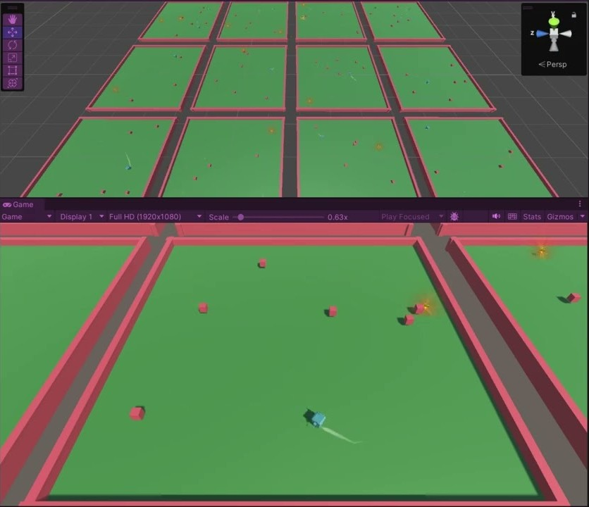
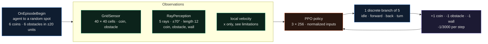
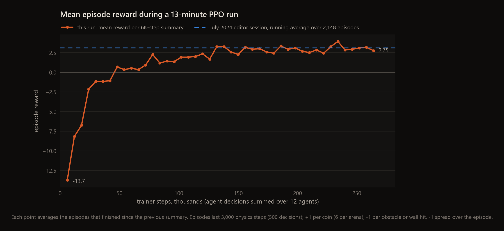

<div align="center">

# Coin Collector

**A Unity ML-Agents arena where twelve agents learn with PPO to collect coins and avoid obstacles, seeing the world through a 40 × 40 grid sensor and five ray casts.**


<a href="https://www.youtube.com/watch?v=vgD67wPSw2s"></a>

</div>

This is an experiment and isn't finished: PPO training works and reaches a mean episode reward of 2.97 out of about 5, but the curriculum isn't part of training yet (see Limitations).
I built this in July 2024 as a course project with Unity's ML-Agents toolkit. Each of the twelve arenas holds one agent, six coins and
six obstacles at random positions. The agent earns +1 for a coin and loses 1 for hitting an obstacle or a wall, and a
small per-step penalty pushes it to be quick. The image links to a video of training in the editor. The repo name
says curriculum: there is a curriculum file, but it was never connected to training (details below).

---

## How it works



`AgentMovement` (an ML-Agents `Agent`) moves with a velocity-change force, turns at 300°/s, and damps its velocity by
5% per step whenever it goes above 5 units/s. A `DecisionRequester` asks for a new action every 6 physics steps and
repeats it in between. `CoinCollectorArea` respawns the coins and obstacles when an episode starts. A collected coin is destroyed (the scene
turns respawning off) and so is an obstacle the agent hits. Walls stay, so a wall costs -1 on every bump. Episodes end
only at the 3,000-step limit; nothing ends them early.

| setting | value |
|---|---|
| arenas / agents | 12, trained in parallel by one PPO learner (behavior `Collecter`) |
| episode | 3,000 steps, decision every 6 steps |
| best possible episode | about +5 (six coins, minus the -1 time penalty) |
| PPO (`config/config.yaml`) | lr 1e-4 linear decay, batch 512, buffer 5,120, 5 epochs, β 0.01, ε 0.2, λ 0.95, γ 0.99, horizon 64 |
| network | 3 layers × 256, input normalization, simple visual encoder for the grid |

## The curriculum that isn't wired in

`Assets/curriculum.json` describes three lessons that raise coin and obstacle density as the agent improves:

| lesson | advance when mean reward reaches | reward_density | obstacle_density |
|---|---|---|---|
| 0 | 100 | 0.1 | 0.05 |
| 1 | 200 | 0.2 | 0.10 |
| 2 | 300 | 0.3 | 0.15 |

It has no effect, for three reasons. The file uses the pre-1.0 ML-Agents curriculum format, which current trainers
don't read; the trainer config has no `environment_parameters` block. No C# code asks for `reward_density` or
`obstacle_density`, because the arena uses its fixed `numCoins` and `numObstacles` fields. And the thresholds are out
of reach: with six coins an episode can't score more than about +5, so a lesson needing 100 would never advance. Every
run so far, mine included, trained a single fixed stage.

## Results

### The July 2024 session

Unity writes timer and gauge data to `Assets/ML-Agents/Timers/SampleScene_timers.json` when Play mode stops. The
committed file comes from a 29-minute editor session on 28 July 2024 (Unity 2022.3.15f1, ML-Agents 3.0.0-exp.1, 12
agents). 2,148 episodes finished in it, and their rewards ranged from -20.0 to +5.0 with a mean of 3.08. The file
doesn't say whether that session was training or running a finished model, and no model or TensorBoard log was
committed, so that summary is all that survives of the original runs.

### An October 2026 rerun

Unity 2022.3 isn't installed on my current machine and the ML-Agents git dependency wouldn't fetch, so I opened a
copy of the project in Unity 6000.3.1f1 with the registry package `com.unity.ml-agents` 4.0.0, built `SampleScene` as
a Windows player (with Burst AOT compilation off, because after the URP upgrade it failed to resolve a ShaderGraph
assembly), and trained it with `mlagents` 1.1.0. The trainer settings are `config/config.yaml` unchanged apart
from `max_steps` and `summary_freq` (6,000, so each summary covers one episode per agent). The run stopped at my time
limit after 264,000 steps and 760 s of trainer time.



The first episodes average -13.7. Obstacles can cost at most 6, since each disappears after one hit, so most of that
is an untrained agent bumping into walls at -1 a bump. Reward turns positive by 48,000 steps and levels off around +3 from about 130,000 steps; the last ten summaries average **2.97**,
close to the 3.08 of the 2024 session. Policy entropy fell from 1.61 (uniform over five actions is ln 5 = 1.61) to
1.09. Episode length sat at the 3,000-step cap in every summary, as expected with no early termination. A perfect episode is worth
about +5, so the agents still miss coins or hit things. The summaries are in `docs/runs/ppo_smoke.csv`.

## Quickstart

```bash
python -m venv venv
venv\Scriptsctivate
pip install mlagents==1.1.0 "setuptools<70"    # Python 3.10; mlagents 1.1.0 still imports pkg_resources

# build Assets/Scenes/SampleScene.unity as a Windows player to Build/RLAgent.exe, then:
mlagents-learn config/config.yaml --run-id=coins --env=Build/RLAgent.exe --no-graphics

python scripts/make_figures.py                   # redraws docs/assets/reward_curve.png from docs/runs/ppo_smoke.csv
```

The usual alternative is to leave out `--env` and press Play in the editor when the trainer asks for it. On a machine
that is busy with other work, set `OMP_NUM_THREADS=4` first: in my run the first PPO update took about three minutes
with PyTorch's default thread count and about ten seconds with four threads.

## Repository map

```text
Assets/Script/Agent/AgentMovement.cs   the agent: observations, actions, rewards, keyboard heuristic (WASD)
Assets/Script/CoinCollectorArea.cs     spawns coins and obstacles at random positions on reset
Assets/Script/ObjectLogic.cs           coin/obstacle pickup: respawn or destroy
Assets/Script/Area.cs                  base class from the ML-Agents examples
Assets/Script/Reward/CoinSpin.cs       spins the coins
Assets/Script/DestroyAfterPlay.cs      cleans up particle effects
Assets/Scenes/SampleScene.unity        the 12-arena training scene
Assets/prefab/                         agent, arena, coin, obstacle and effect prefabs
Assets/curriculum.json                 the unused lesson plan above
Assets/ML-Agents/Timers/               timer and reward gauges Unity saved from the July 2024 session
config/config.yaml                     PPO trainer settings
docs/runs/ppo_smoke.csv                summaries from the October 2026 run
scripts/make_figures.py                draws docs/assets/reward_curve.png from that CSV
```

## Limitations

- The curriculum is not connected (see above), so the repo name promises more than the training does.
- The agent declares a vector observation of size 1 but `CollectObservations` writes two values (local x and z velocity). ML-Agents logs "More observations (2) made than vector observation size (1)" on every step and drops the second one, so the forward speed never reaches the policy.
- Nothing ends an episode early. Once the six coins are gone the agent keeps moving until step 3,000, and wall bumps keep costing reward.
- `Packages/manifest.json` points ML-Agents at the git main branch, so a fresh checkout resolves whatever main is at the time; `packages-lock.json` pins the July 2024 commit. The 2024 numbers come from Unity 2022.3.15f1 and the 2026 rerun from Unity 6000.3 with ML-Agents 4.0.0, so they are similar runs, not the same one.
- The repo is about 170 MB, and 154 MB of that is the MasterStylizedFX effects pack.

## License

MIT for the scripts, scene and configs, see [LICENSE](LICENSE). `Assets/MasterStylizedFX` (Unity Asset Store effects)
and `Assets/TextMesh Pro` keep their own licenses.
